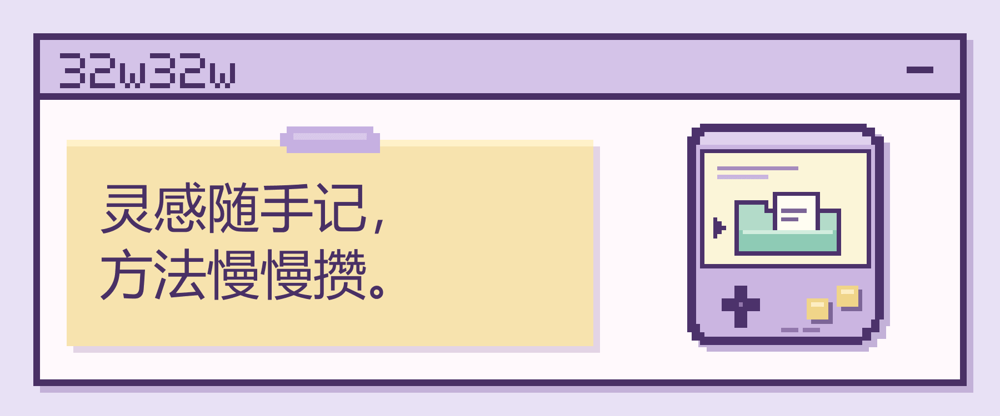

你好，我是 **32w32w**，欢迎来我的像素小工坊。我和 AI 一起画画、做设计，也把改稿时反复用得上的办法写成小工具，放在这里分享。

## 工坊手记 ·《闭馆以后》

美术馆关门以后，挂在隔壁的两幅画会串门吗？

我让《最后的晚餐》里的一只奶蛙把圆面包递出画框。隔壁《雅典学院》的几何老师探过身来，拿圆规在面包上比了比，一脚点在正中，另一脚刚好碰到外皮。

我想让人第一眼只看到月光下安静的展厅，再看一眼，才发现几何老师还没下课。[读《闭馆以后》的构思稿](https://github.com/32w32w/my-skills/blob/main/skills/painting-styles-and-techniques/examples/after-hours.md)

## 正在做的小工具

### [my-skills](https://github.com/32w32w/my-skills)

个人可复用技能集合，收录我写的视觉设计和绘画技能，也提供配套视觉设计技能的安装入口。

- [**Visual Art Director**](https://github.com/32w32w/my-skills/blob/main/skills/visual-art-director/SKILL.md) 用于参考图分析、设计评价和风格协调。
- [**Painting Styles and Techniques**](https://github.com/32w32w/my-skills/blob/main/skills/painting-styles-and-techniques/SKILL.md) 用于查找馆藏原作、比较画法、构思新作品和评审画稿。

[查看安装说明](https://github.com/32w32w/my-skills#整套安装到-codex)

配套技能的来源与使用说明，见 my-skills 仓库。

喜欢这个风格？[使用像素小工坊模板](https://github.com/32w32w/32w32w/tree/main/template/pixel-workshop)，换成自己的昵称、介绍和项目。
