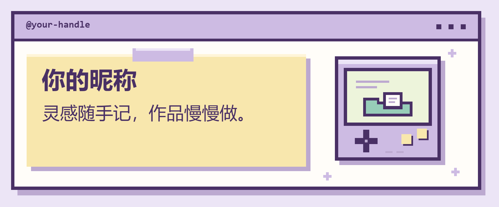

# 像素小工坊 · GitHub 主页模板

把便签、掌机和自己的小项目放进同一张像素工作台。填写你的信息，导出一张横幅和一份正文，就能用于自己的 GitHub 个人主页。



**[下载前先打开填写页文件](customize.html)** · [查看成品示例](profile/README.md) · [详细修改说明](CUSTOMIZE.md)

## 从这里开始

1. 打开上面的 `customize.html` 文件，在 GitHub 文件页面点击 **Download raw file（下载原始文件）**，将它保存到电脑。GitHub 的文件页面只展示代码，不会运行这个填写页。
2. 双击下载的 HTML，用浏览器打开。把 `your-handle`、昵称、简介和示例项目替换成自己的内容；可选择紫色、薄荷或蜜桃配色。
3. 在填写页分别下载 **README.md** 和 **banner.png**。还可以保存 `profile.json`，下次打开填写页时导入，继续修改。
4. 在自己的 GitHub 账号下创建一个**公开、与用户名同名**的仓库。例如用户名是 `your-handle`，仓库名也应是 `your-handle`。
5. 将下载的文件放成下面的结构并提交。确认正文和图片在仓库里显示正常，再查看个人主页。

```text
你的同名仓库/
├── README.md
└── assets/
    └── banner.png
```

填写与导出均在本地浏览器完成，不要求登录，也不会自动联网或上传。`profile.json` 用来留存填写内容，不必上传到主页仓库。

## 也可以直接改文件

复制 [`profile/README.md`](profile/README.md) 和 [`profile/assets/banner.png`](profile/assets/banner.png)，按照上述结构放到自己的仓库。用文本编辑器替换昵称、介绍、项目及链接；横幅可通过填写页重新导出，或换成自己的图片。

这里的 `your-handle`、昵称和项目都是**示例占位内容**，不代表真实账号或项目。使用前请逐项替换。更多字段说明见 [CUSTOMIZE.md](CUSTOMIZE.md)，导入配置可参考 [profile.example.json](profile.example.json)。

## 主页显示规则

GitHub 显示的是**公开同名仓库根目录**中的 `README.md`。只把本模板文件夹上传到仓库、给仓库取其他名字，或将仓库设为私有，都不会自动显示成个人主页。[GitHub 官方说明](https://docs.github.com/en/account-and-profile/how-tos/profile-customization/managing-your-profile-readme)

这套模板负责横幅和 README 正文，GitHub 自身的导航、头像栏和仓库卡片仍由 GitHub 管理。
