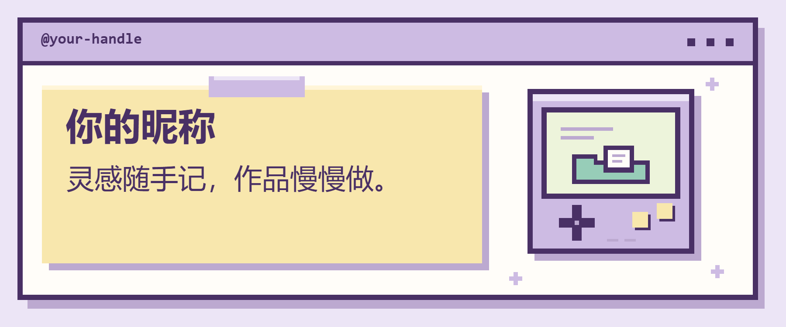

你好，我是 **你的昵称**。

这里是你的简介。可以写下你在学习什么、正在制作什么，以及希望与谁交流。

## 正在做的小项目

### [示例项目一](https://github.com/your-handle/example-project-one)

用一句话说明这个项目能帮谁解决什么问题。

### [示例项目二](https://github.com/your-handle/example-project-two)

写下另一个想展示的作品，也可以删除这一项。

## 工作台便签

- 正在学习：填入你最近研究的主题。
- 正在制作：填入你想完成的小作品。
- 欢迎交流：填入你感兴趣的话题。
